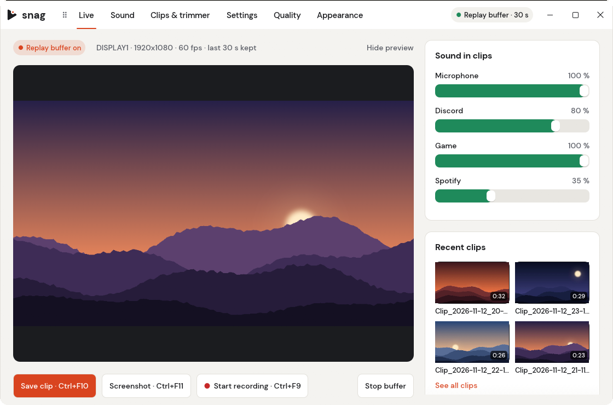
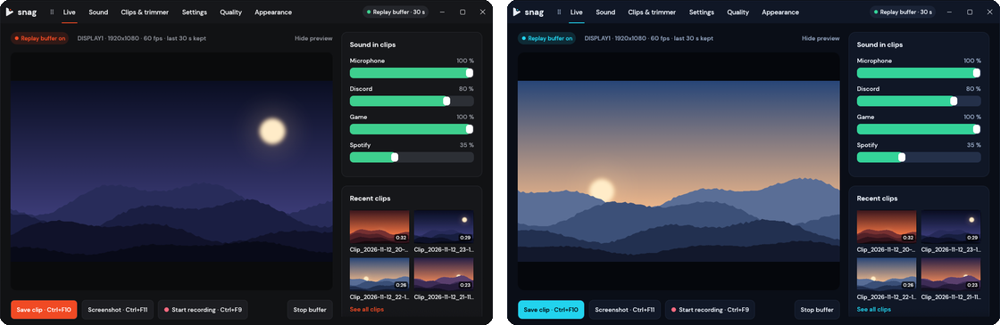

  <picture>
    <source media="(prefers-color-scheme: dark)" srcset="docs/images/logo-dark.svg">
    
  </picture>

<h1 align="center">snag</h1>

  <b>Catch the play. Keep the game smooth.</b> 
  A small, fast clipping app for Windows: instant replays, full-session recording, 
  screenshots and a built-in trimmer, with hardware encoding that barely touches your FPS.

  

  
  
  

  

## What it does

**Never miss a play.** Snag quietly keeps the last 30 seconds. Press <kbd>Ctrl</kbd>+<kbd>F10</kbd> and it's saved as an MP4, without interrupting anything.

**Record whole sessions.** Start and stop a recording with <kbd>Ctrl</kbd>+<kbd>F9</kbd>, or let Snag record everything from the moment it starts and keep only what you want.

**Your sound, your way.** Game, Discord, Spotify and your microphone, mixed into every clip. Record the whole PC, or tick just the apps you want, each with its own volume, even when they play on different headsets or speakers.

**Light on your PC.** Uses your graphics card's video encoder (NVIDIA, AMD or Intel) and picks the best quality your hardware handles. While you play, Snag is just a tray icon.

**Trim in seconds.** A built-in trimmer with sound: cut losslessly in an instant, or frame-exact.

**Any key you like.** Any key or mouse button works as a hotkey, and it works inside games.

**Make it yours.** Five themes, a tab bar you can drag to any edge, an icons-only mode and adjustable size.

## Get started

1. **[Download Snag-Setup.exe](https://github.com/ezph4ntom/Snag/releases/latest)** and run it. No administrator rights needed.
2. Keep **Install ffmpeg** ticked if it's offered (Snag uses it to encode).
3. Play. Snag lives in the tray, and the replay buffer is already running.

| To | Press |
|---|---|
| Save the last 30 seconds | <kbd>Ctrl</kbd>+<kbd>F10</kbd> |
| Screenshot | <kbd>Ctrl</kbd>+<kbd>F11</kbd> |
| Start / stop recording | <kbd>Ctrl</kbd>+<kbd>F9</kbd> |
| Open Snag | click the tray icon |

Clips land in `Videos\Snag`. Hotkeys, clip length, folders and everything else are in **Settings**.

## Themes

Daylight is the default. Prefer the dark side? Pick **Graphite**, **Midnight**, **Warm Ink** or **OLED** under Appearance, or [make your own](themes/README.md).

  

## Questions

<b>Windows says "Windows protected your PC"</b>

 
Snag isn't code-signed yet, so SmartScreen doesn't know it. Click <b>More info</b>, then <b>Run anyway</b>.

<b>Does it lower my FPS?</b>

 
Barely. Video is encoded on your graphics card's dedicated encoder; Snag and its encoder together use about 1–2% CPU while recording. Auto-tune picks settings your PC handles comfortably, and you can always choose a lighter preset in <b>Quality</b>.

<b>A hotkey doesn't work in one game</b>

 
That game probably runs as administrator. Pick a key combination with Ctrl, Alt or Shift, or use <b>Settings → Hotkeys → Restart Snag as administrator</b>.

<b>Clips have no sound, or are missing Discord</b>

 
Open the <b>Sound</b> tab. "Recording now" lists everything being captured. With <i>Whole PC audio</i> on, every output is recorded; otherwise tick the apps you want.

<b>What do I need?</b>

 
Windows 10 (October 2018 update or newer) or Windows 11, and ffmpeg, which the installer sets up for you.

## Feedback

Found a bug or have an idea? [Open an issue](https://github.com/ezph4ntom/Snag/issues/new/choose). For bugs, attaching `%LOCALAPPDATA%\Snag\logs\core.log` helps a lot.

Want to build Snag yourself or see how it works? Read [DEVELOPING.md](docs/DEVELOPING.md).
